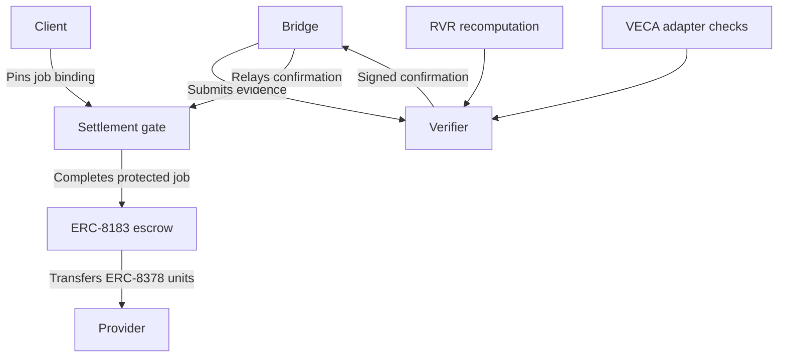

# ERC-8378 × RVR × VECA — Verifier-Gated Settlement V1

**Draft review material. ITERATE / Production HOLD.**

This additive experiment connects a real ERC-8378 Prediction token and an unchanged
ERC-8183 escrow to an experimental RVR/VECA settlement adapter. Payment for a protected
job requires a current, correctly bound signature from one configured verifier. A bridge
signature or `verified=true` flag cannot replace that confirmation.

This is verifier-authorized settlement. The verifier's signature does not prove the
truth of an off-chain judgment. It is not a trustless-settlement claim or a production
approval. VECA contributes its unchanged conjunction reducer; this experiment is not
a natively registered VECA settlement profile.

## Scope and provenance

Private baseline: `3ecd05e97499463e54992fe57f5f223a7532a955`, parent
`10c5872c4c325a9f169576c4b0a66e32bf89e22c`. Its validated local evidence ZIP has SHA-256
`95d99eb26ef340b2ae5cb6b6bed0c77931b87890455967e0c40586eccbdda38d`.
The baseline archive and Git bundle are **not publication artifacts**: they contain
fixed test signing material and personal host/commit metadata. No private key, seed,
mnemonic, raw bundle, raw host log or old archive is included in this review lane.

The review copy replaces embedded test keys with ephemeral runtime credentials,
fetches only hash-pinned dependencies, and adds review documentation. The settlement
contracts and frozen upstream dependencies remain byte-identical to the baseline.
The original local history is preserved privately and is not a parent of this PR.
See [baseline provenance](BASELINE.json), [dependency manifest](dependency-manifest.json),
[wire/signing specification](FORMAT.md), and [review questions](REVIEW.md).

## Architecture and roles



| Role | Authority |
| --- | --- |
| Client | Funds the job and pins its nonzero complete binding once |
| Bridge | Fixed allowed relayer; cannot approve evidence or replace/revoke verifier |
| Verifier | Independently selects policy, recomputes evidence, checks state and signs a complete confirmation |
| Verifier authority | Separate immutable address; can revoke the verifier permanently or advance epoch, not sign payouts |
| Gate | Checks caller, signature/domain, exact success outcomes, binding, freshness, nonce, job and token context |
| Escrow | Only its named evaluator completes that job; expiry refund returns to the original client |

V1 currently restricts `settle` to its configured bridge address. Permissionless
relaying is a future design choice, not current behavior. Distinct addresses do not
establish independent controllers or operational custody.

`LockedGateFactory` atomically creates the escrow/gate pair and renounces the initial
escrow administrator and upgrade roles before funding. The tested token Router and
PredictionEngine ownership is also renounced by the test controller. Protected jobs
must name this gate, use zero hook/fees, and fit the tested Normal-account Prediction
parameter profile. Old evaluators, arbitrary escrow deployments and retained admins
are outside that supported topology.

## Reproduce on another machine

Use a short checkout path on Windows. Prerequisites: Python 3.12, Foundry 1.7.1,
solc 0.8.30. Activate a virtual environment so the `python` used by Foundry FFI resolves
to the same environment. From this review directory:

```sh
python -m venv .venv
# Activate .venv using your shell's normal activation command.
python -m pip install -r requirements-replay.txt
python prepare_dependencies.py
python -B review_replay.py reviewer --mutations
```

The dependency preparer obtains immutable upstream files and verifies every SHA-256
before use, including all 13 frozen Core files in both RVR and VECA copies. Existing
files with the wrong hash are refused. ERC-8183 Solidity is extracted from the pinned
specification and verified against the exact baseline byte digest. No vendored source
is silently upgraded or patched. An offline, pre-provisioned cache can be used with
`python prepare_dependencies.py --from-cache PATH_TO_VERIFIED_CACHE`.

The review runner performs normal/repeat/`-O`, then 20 physical mutations. It provisions
one ephemeral credential set outside the checkout, supplies keys only to test
processes, and removes the temporary credentials on exit. No key value is printed or
exported. This is test isolation on one host, not production key custody. A standalone
`gate-v2/reproduce.py NEW_NAME` or `gate-v2/physical_mutations.py NEW_CAMPAIGN RUN_NAME`
also provisions temporary credentials automatically. Never reuse run names.

To check the provided public sample without any signing key:

```sh
python -B gate-v2/offline_checker.py evidence
```

For new local evidence, use the newly generated run directory. The checker imports
no producer, bridge or issuer implementation. It separately rebuilds the expected
confirmation, digest/domain, ECDSA recovery, native transfer/completion events and
negative cases; it shares the pinned native RVR dependency. It is a separate checker
implementation by the same author/host, not an independent audit or consensus proof.

## Verified behavior and explicit counterexamples

The baseline had 68/68 contract tests, 48/48 offline checks, 43/43 issuer controls and
20 KILLED / 0 SURVIVED / 0 INVALID physical mutations, with 13/13 frozen Core files
unchanged. The cleaned review copy is tested again; its actual results and public
sample are in [evidence/review-results.json](evidence/review-results.json).

Required controls cover missing confirmation, bridge signature, forged flag, all 21
confirmation field substitutions, validly signed wrong job/recipient/token/amount,
wrong/revoked signer, expiry/epoch, other chain/gate/escrow, nonce reuse across jobs,
second payout, negative RVR/recomputation/admission outcomes, actual submitted digest
substitution, direct complete/reject, upgrade/role/fee/reinitialize/hook/transferFrom
paths and role aliasing. A failed payment consumes no nonce or funds.

The positive integration invokes real frozen RVR recomputation and the experimental
adapter in Python, then a real native gate/escrow/Prediction-token payout of exactly
100 test units once. No mock token or simulated transfer replaces it. Tests run only
inside Foundry's local EVM, with an FFI state/event transport; no public transaction
or deployment is implied. The live RPC reader is not validated by these tests.

Two successful counterexamples intentionally remain tests: an explicitly unlocked
escrow administrator can upgrade around a gate, and a compromised configured verifier
can sign a fabricated assertion that pays. The factory excludes the former topology;
single-verifier trust remains. The old bridge-trusting evaluator is retained solely
as a baseline control and does not acquire the new gate's guarantees.

## Remaining trust and future threshold design

| V1, implemented | Future threshold design, not implemented |
| --- | --- |
| One immutable ECDSA verifier address | Explicit threshold policy over separately administered seats |
| Single signature authorizes a bounded confirmation | Enough eligible seats must sign the same complete job/evidence/domain/expiry/nonce |
| Separate revocation/epoch authority | Reviewed seat enrollment, rotation, revocation, threshold changes and failure policy |
| Fixed bridge relayer | Possible permissionless relay without approval authority |
| One developer host and ephemeral test identities | Actual organizational independence, authenticated key distribution and custody evidence |

More keys on the same host do not establish more independent verifiers. This PR does
not implement a threshold, a ZK wrapper or complete on-chain RVR/VECA execution.
Exact-answer/SHA-256 checks could be enforced on-chain, but they would not reproduce
all frozen profile, authority and admission semantics. No impossibility claim is made.

Policy adequacy, assessor authority, verifier correctness, authentic state reads,
funding-time commitment and token economics/liveness remain explicit review topics.
Unsolicited token parameter changes can cause refusal; safety is not a liveness proof.

## Federico's independent review

Federico needs this review commit, Python/Foundry prerequisites, pinned dependency
manifest, the public evidence sample, [FORMAT.md](FORMAT.md), and his independently
chosen policy. He can verify the public sample without receiving any private key,
then generate fresh local evidence with his own runtime credentials and return the
exact reviewed commit, manifest digest, commands/results and any counterexample.

Taking a future live verifier seat additionally requires his own separately held
secp256k1 key, authenticated public-key enrollment, agreed chain/gate/escrow/job and
policy, independent state reads and revocation rules. The present immutable gate
does not enroll a new seat dynamically. Do not send a private key, seed or mnemonic.
An independently signed report is not production settlement approval.
